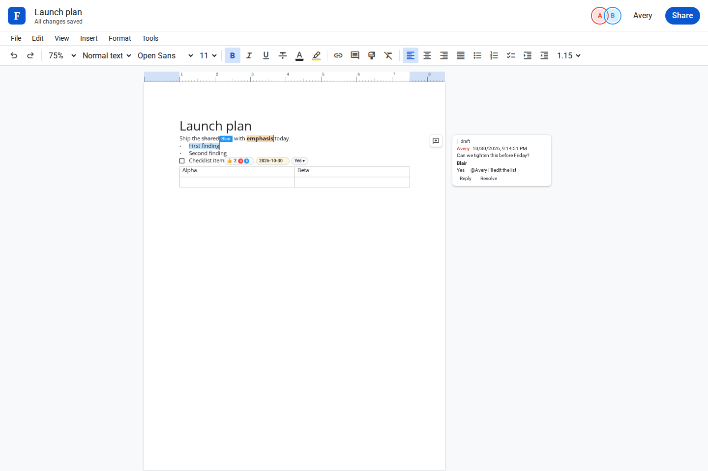

# FiPen

FiPen is a real-time collaborative rich-text editor. Several people can edit one document at once. Remote carets stay on the page; a person's name shows when you hover their caret, their selection, or their avatar.



## Roadmap

FiPen is the writing app. FiGrid, the spreadsheet, is served from the same process at [/sheets](http://localhost:8787/sheets). New documents are `.fipen` files and new spreadsheets are `.figrid` files. Older `.felarumi` and `.felanumio` files still open.

## Run

Requires Node.js 22.18 or newer.

```bash
npm install
npm start
```

Open http://localhost:8787 , create a blank document, and open the same URL in another tab. `npm run dev` restarts the server when `src/server` or `src/shared` changes.

Documents live in SQLite under `data/` (override with `DATA_DIR`). The default port is `8787` (`PORT`).

```bash
npm test
npm run test:e2e
```

`npm test` includes a randomized operational-transform fuzz. `npm run test:e2e` drives two browsers with Playwright.

## Static peer host

On the `p2p` branch the same editors also build into a static site. `npm run p2p` writes `p2p/dist/` and serves it. There is no document server: the owner's browser sequences edits over Trystero (public Nostr relays), and the share link's fragment is the room password. Other people can edit only while that owner is online. Snapshots autosave in IndexedDB. End session offers a Filecoin save through the Synapse SDK on mainnet, with a Calibration toggle, plus an optional IPFS token and a file download. A wallet or a key is entered at runtime and is never stored in the repo. `npm run test:p2p` covers convergence, the owner-offline lock, and the file adapter against the local static host.

## How it works

The document is a flat string plus per-character styles (bold, italic, underline, strikethrough, super/subscript, font, size, color, highlight, links, lists, spacing, indent, and embedded chips). Edits are insert, delete, and style deltas. The browser turns those into 1-based `is` / `ds` / `as` / `mlti` commands. A chip is one object-replacement character; votes are per-session attributes so concurrent ballots merge. Comment anchors are a mark on the characters they cover, so they move with the text. Comment bodies sync beside the op log.

A Node server is authoritative. Each client batch is tagged with a base revision, a session id, and a request id. The server transforms the batch against revisions the client has not seen yet, assigns the next revision, acks it (duplicate request ids are ignored), and broadcasts the canonical batch over a WebSocket. Clients keep one in-flight batch and one pending batch and rebase both when a remote edit arrives. Undo and redo are inverse deltas computed on the client. Concurrent inserts at the same index are ordered by session id, so arrival order does not change the result.

The page is painted on a canvas (816×1056). Keystrokes, IME, and paste go to an offscreen `contenteditable`. Remote carets sit on an overlay.

## Fonts and icons

These files are vendored under `public/fonts/`:

- Roboto and Roboto Mono, Apache-2.0
- Open Sans, SIL Open Font License
- Lora, SIL Open Font License. "Lora" is a Reserved Font Name.
- Material Symbols Outlined, Apache-2.0

License texts are in that directory.
